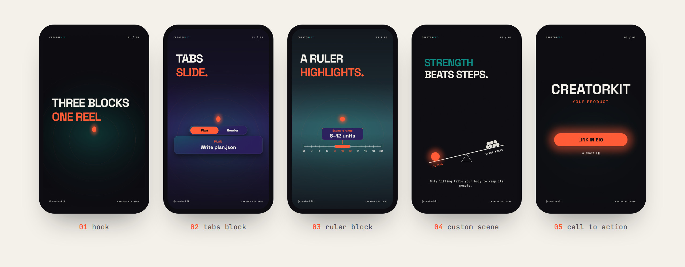
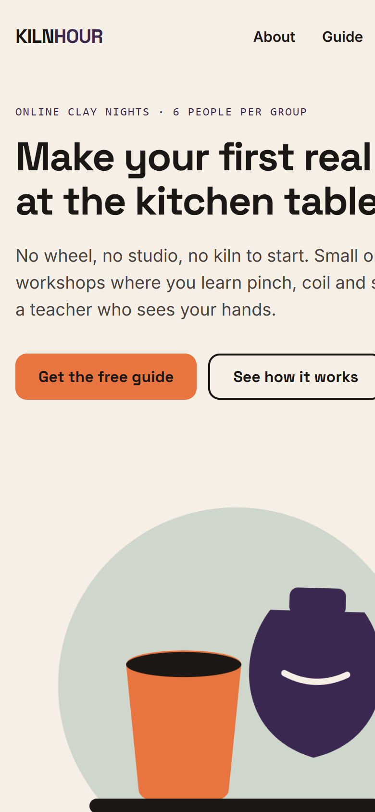

<p align="center">
  
</p>

<p align="center">
  <a href="LICENSE"></a>
  
  
  
</p>

<p align="center">
  <b>A free, open-source kit for <a href="https://claude.com/claude-code">Claude Code</a>.</b><br>
  Describe your brand once. Make motion-graphics reels and fast websites that look like you.
</p>

<p align="center">
  <a href="#quick-start">Quick start</a> ·
  <a href="#how-it-works">How it works</a> ·
  <a href="#posting">Posting</a> ·
  <a href="#sites">Sites</a> ·
  <a href="#whats-inside">What's inside</a> ·
  <a href="#roadmap">Roadmap</a> ·
  <a href="docs/reels-remotion.md">Reels guide</a>
</p>

---

> [!NOTE]
> **Creator Kit v2 is being built in the open.** Two reel engines (Remotion and HyperFrames), B-roll search, a local dashboard, the site builder and the one-command setup work today. Your brand lives in one file, [`brand/brand.yaml`](brand/brand.yaml). What is left is on the [roadmap](#roadmap).

## How it works

<p align="center">
  
</p>

1. **Describe once.** Name, voice, colours, fonts, content pillars and site details go in one brand file. Keys and tokens stay in `.env` and never in the brand file.
2. **Make reels.** Write a script or a monthly plan. The kit renders 1080×1920 reels with captions, voice-over, music and a review sheet.
3. **Make sites**. The same brand file drives a React + Vite + Tailwind site with SEO built in, ready for Cloudflare Pages.

Claude Code runs the steps for you and stops at the gates that need a human: approving a script, recording a voice, publishing a post.

## What the reels look like

<p align="center">
  
</p>
<p align="center"><sub>Real frames rendered by the kit from the example month in <code>reels/content/example/</code>, using the demo brand.</sub></p>

## Quick start

**Before you start** you need a [Claude Pro plan](https://claude.com/pricing) (or higher) and [Claude Code](https://claude.com/claude-code) installed. That's it: the setup installs everything else. It takes 10 to 20 minutes and about 3 GB of space.

### 1. Download the kit

On this page, click the green **Code** button → **Download ZIP**, and unzip it somewhere easy to find, like your Documents folder. (Know git? `git clone https://github.com/vgorla99/creator-kit.git` works too.)

### 2. Run the setup (one command)

Open a terminal **inside the kit's folder**:

- **Windows:** open the folder in File Explorer, click the address bar at the top, type `powershell` and press Enter.
- **Mac:** open the Terminal app, type `cd ` (with a space), drag the folder onto the Terminal window and press Enter.

Then copy this line, paste it and press Enter:

| Windows | Mac |
|---|---|
| `powershell -ExecutionPolicy Bypass -File setup\setup.ps1` | `bash setup/setup.sh` |

The setup asks what you want to make (reels, websites or both) and, for reels, which video engine. Then it lists everything it will install and **waits for your yes**. It installs only what is missing (Node.js, Python, uv, ffmpeg, Git, GitHub CLI), the kit's packages and its Claude Code skills, then checks everything and renders a test picture. Windows may ask for permission once or twice; click **Yes**.

It ends with **Done** or tells you, in plain English, what to fix. You can run it again any time; it picks up where it left off. To re-check later: `npm run doctor`.

### 3. Make it yours: `/brand-intake`

Open Claude Code in the same folder (type `claude` in that terminal, or open the folder in the Claude desktop app) and type:

```
/brand-intake
```

Claude asks one question at a time (name, audience, colours, fonts, voice, posting days…) and writes your brand file. Until you do this, the kit uses an invented example brand, Kiln Hour.

### 4. Your first reel or website

- **Reel:** type `npm run starter` in the terminal. Your 12-second starter reel, in your colours, lands in `reels/studio-remotion/out/Starter.mp4`. Or just tell Claude: *"make a reel about …"*. It plans with you, shows you stills, and only renders when you say OK.
- **Reel with HyperFrames** (if you picked it): `npm run hf:render` renders the 10-second HTML starter to `reels/studio-hyperframes/out/starter.mp4`; `npm run hf:preview` opens it in your browser. Which engine to pick: [docs/engines.md](docs/engines.md).
- **B-roll:** tell Claude `/broll-scout` and what you need. It searches your own footage, Wikimedia Commons, Pexels and Pixabay, shows a preview sheet, and adds only the clips you pick, with source and licence logged.
- **Dashboard:** `npm run dashboard`, then open http://localhost:5180 to review every reel from draft to live, edit captions, see your month and which hooks win. It runs on your computer only.
- **Website:** tell Claude `/site-builder`. It plans the pages with you, builds them, and walks you through putting the site online for free. Step by step: [Launching your website](docs/sites-launch.md).

Nothing is ever posted without you: posting is a separate step where Claude shows you the exact video, channel, time and caption and waits for your yes.

<details>
<summary><b>Useful commands</b> (all run from the kit's folder)</summary>

| Command | What it does |
|---|---|
| `npm run doctor` | checks your computer and the kit, and explains any fix |
| `npm run brand:check` | checks your brand file and tells you in plain English what to fix |
| `npm run starter` | renders the starter reel in your brand colours, plus a review sheet |
| `npm run produce -- example --only V01` | renders the example month's video: video, cover, review sheet, voice-over script, post text |
| `npm start` | opens Remotion Studio in your browser, where you can scrub every reel |
| `npm run hf:preview` · `hf:check` · `hf:render` | the HyperFrames studio: preview in the browser, check, render |
| `npm run dashboard` | the local dashboard on http://localhost:5180 (Ctrl+C stops it) |
| `npm run broll -- search "<words>"` | searches stock B-roll (Claude's `/broll-scout` does this for you) |
| `npm run library -- credits` | prints the credit lines your post needs for the clips you used |

Keys for optional services go in `.env` (the setup creates it; every key is optional and stays on your computer). `npm run doctor` tells you which stock keys are set without showing them; Wikimedia Commons needs no key.

| Key | Used for |
|---|---|
| `PEXELS_API_KEY` | stock clips from Pexels (free key: [pexels.com/api](https://www.pexels.com/api/)) |
| `PIXABAY_API_KEY` | stock clips from Pixabay (free key: [pixabay.com/api/docs](https://pixabay.com/api/docs/)) |
| `ELEVENLABS_API_KEY` | voice-over |
| `POSTIZ_API_KEY`, `POSTIZ_API_URL` | scheduling with Postiz (see [Posting](#posting)), and the dashboard's queue and numbers |
| `PUBLORA_API_KEY` | scheduling with Publora |

Plan a month: copy [`reels/content/example/`](reels/content/example/) to `reels/content/<yyyy-mm>/`, edit its `plan.json` (Claude Code can draft it from your brand file and your numbers), then `npm run produce -- <yyyy-mm> --week 1`. Sound effects: see [`reels/sounds/SOUND-LIBRARY.md`](reels/sounds/SOUND-LIBRARY.md). The full reference is in the **[reels guide](docs/reels-remotion.md)**.

</details>

<details>
<summary><b>If something goes wrong</b></summary>

- **"running scripts is disabled on this system"** (Windows): use the exact line above; it starts with `powershell -ExecutionPolicy Bypass`, which allows the setup to run once without changing your settings.
- **"was installed, but this window cannot see it yet"**: close the terminal, open a new one in the kit's folder, and run the setup again.
- **No `winget`** (older Windows 10): install **App Installer** from the Microsoft Store, then run the setup again.
- **Anything else:** every run saves a log in `setup/logs/` (it never contains your keys). Open Claude Code in the folder and ask it to read the newest log and help.

</details>

## Posting

Rendering never posts anything. When a reel is approved, schedule it one of three ways:

| Route | Cost | Effort | Guide |
|---|---|---|---|
| Each platform's own scheduler | free | a few minutes per reel, per platform | [Native schedulers](docs/posting-native.md) |
| Postiz on your own small server | about €7–8/month, or €0 on a free-tier server | about 2 hours to set up, then one calendar | [Postiz self-hosted](docs/postiz-self-host.md) |
| Postiz Cloud | from $29/month | 20 minutes, nothing to maintain | [Postiz Cloud](docs/postiz-cloud.md) |

## Sites

The same brand file builds a website: React + Vite + Tailwind, one real HTML page per URL, SEO built in, free hosting on Cloudflare Pages.

<p align="center">
  
  
</p>

- **Pages:** home (hero, offer, proof, lead form and pop-up), about, contact, and a long-answer article that answers one real question in full.
- **SEO pack:** sitemap, `robots.txt` that welcomes AI crawlers, `llms.txt`, JSON-LD structured data, titles, descriptions and share images. `npm run check-seo` checks all of it.
- **Fast and accessible:** the example scores 100 on all four Lighthouse scores on mobile. Fonts are self-hosted, and motion switches off for visitors who ask for reduced motion.
- **Two Claude Code skills:** `/niche-research` (competitors, long questions, answer gaps) and `/site-builder` (plan → your OK → build → SEO pack → launch, then a monthly Search Console check).

```bash
cd sites/template
npm install
npm run build && npm run check-seo
```

Step by step, for non-developers: **[Launching your website](docs/sites-launch.md)** (build, Cloudflare Pages, your domain, Search Console).

## What's inside

| Path | What it is |
|---|---|
| `brand/` | your brand: `brand.yaml` (the facts) and `STYLE.md` (the feel) |
| `schema/` | the rules for `brand.yaml` and the checker behind `npm run brand:check` |
| `reels/studio-remotion/` | the Remotion reel studio: starter reel, footage engine, 10 animated blocks, captions, carousels, scripts |
| `reels/studio-hyperframes/` | the HyperFrames reel studio: a starter reel built as an HTML page (`npm run hf:render`) |
| `reels/dashboard/` | the local dashboard: review, captions, calendar, numbers, Style rounds (`npm run dashboard`) |
| `reels/content/` | what you post: ideas, ready, live, metrics, and month plans (`example/` renders on a fresh copy) |
| `reels/sounds/` | how to get and index sound effects (the packs themselves stay on your computer) |
| `sites/template/` | the website template: React + Vite + Tailwind, SEO scripts |
| `sites/research/` | your niche research and monthly notes (stays on your computer) |
| `setup/` | the one-command setup, `doctor`, and the list of skills it installs (`skills.lock.yaml`) |
| `.claude/` | how Claude works here (`CLAUDE.md`), safe permissions, and the kit's own skills |
| `docs/` | guides: reels, posting, site launch |
| `assets/` | Creator Kit logo files and README images |

## Roadmap

- [x] Remotion reel engine, footage engine, monthly plans, carousels
- [x] Production scripts: stock clips, voice-over, review documents, scheduling
- [x] One `brand.yaml` with a schema, plus a guided brand intake and an invented example brand
- [x] `reels/` restructure: Remotion studio, content folders, sound library guide
- [x] HyperFrames studio as a second reel builder, side by side with Remotion
- [x] One-command setup for Windows and macOS, with a `doctor` check (tested on Windows; the macOS script is syntax-checked, not yet run on a Mac)
- [x] `broll-scout`: licence-logged B-roll from your footage, Wikimedia, Pexels and Pixabay
- [x] Local dashboard: plans, review, style, analytics
- [ ] Posting guides: Postiz self-hosted, Postiz Cloud, native schedulers (written; self-host guide being tested on a fresh server)
- [x] `sites/`: React + Vite + Tailwind template, niche research, Cloudflare Pages deploy
- [ ] Guides with screenshots for every part, then the v2.0.0 release

## Principles

- **Your brand, not ours.** Examples use a neutral demo brand. Nothing in the repo belongs to a real business.
- **Secrets stay local.** Keys live in `.env`, which is git-ignored. Nothing is uploaded unless you run a publishing command.
- **A human approves anything public.** Nothing is posted by a render; scheduling is a separate command you run after reviewing the post.
- **Installed, not copied.** Third-party skills and tools are installed from their own repositories, with their own licences.

## Earlier versions

| Tag | What it is |
|---|---|
| [`v1.1.0`](https://github.com/vgorla99/creator-kit/tree/v1.1.0) | ReelsMaker: morphing single-protagonist motion kit |
| [`v1.0.0`](https://github.com/vgorla99/creator-kit/tree/v1.0.0) | ReelsMaker: JSON-script text-card reels |

This repository was called `reelsmaker`; old links redirect here.

## License

Code: [MIT](LICENSE). Fonts: SIL Open Font License. Third-party skills and tools: see [CREDITS.md](CREDITS.md).

[Remotion](https://www.remotion.dev) has its own licence. It is free for individuals and companies of up to 3 people; larger companies need a [Remotion company license](https://www.remotion.dev/license).

<!-- TIP_URL: add the Buy Me a Coffee link here once the page exists. -->
