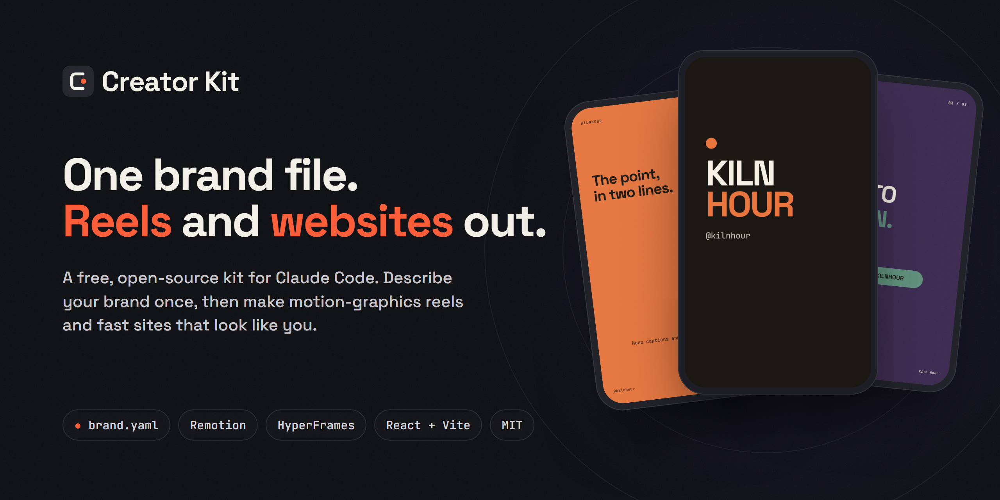
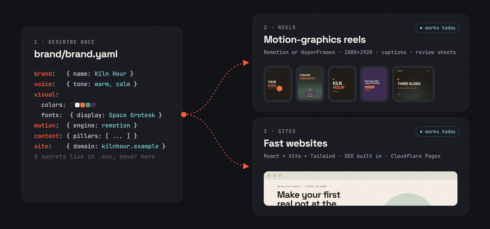
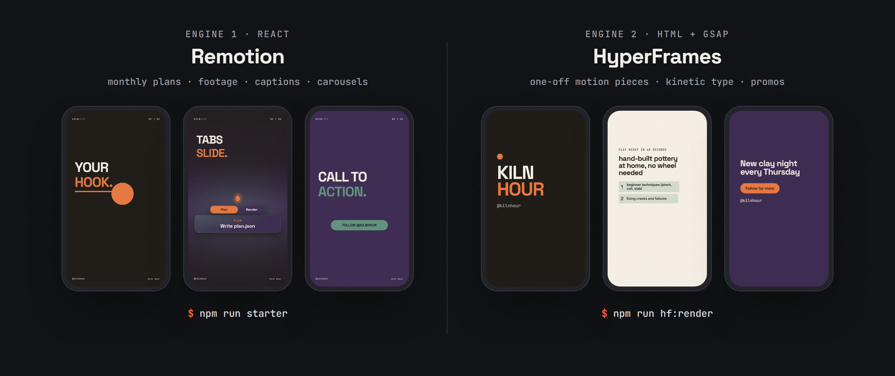
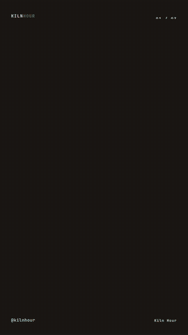
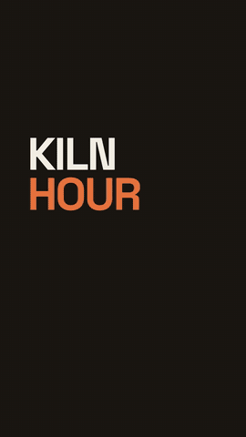
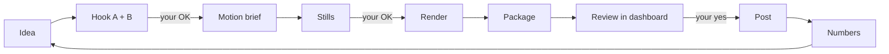
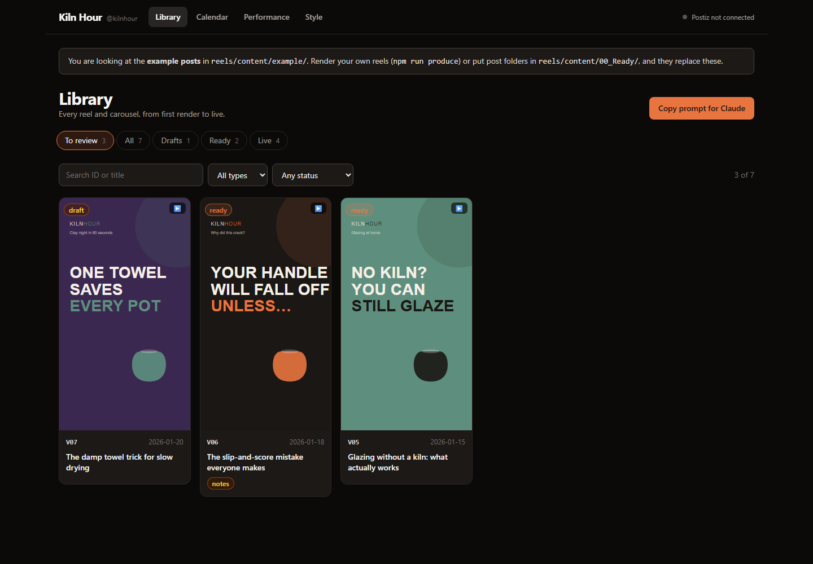
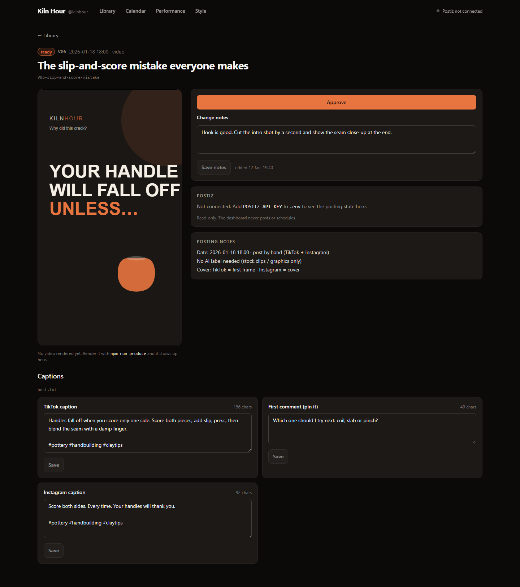
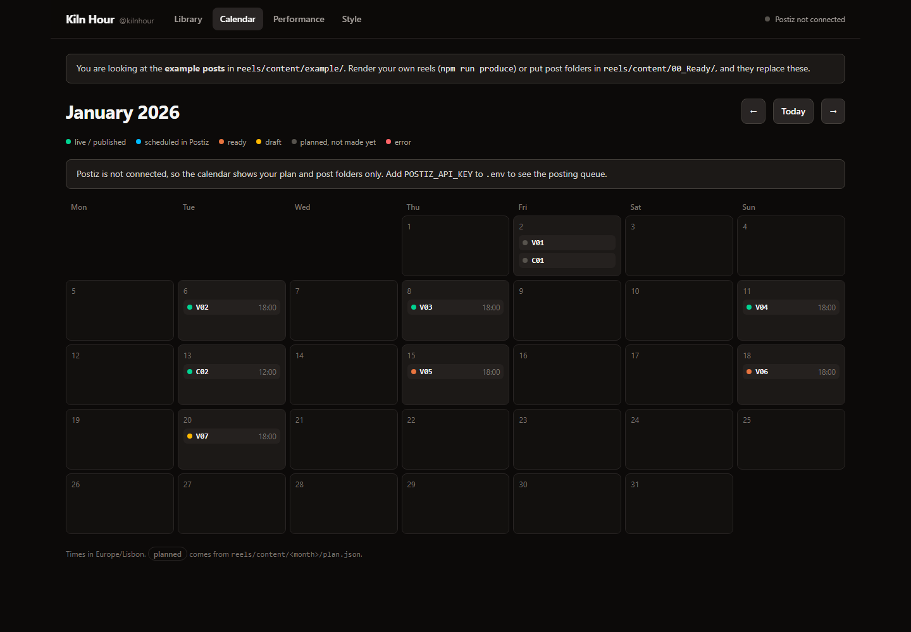
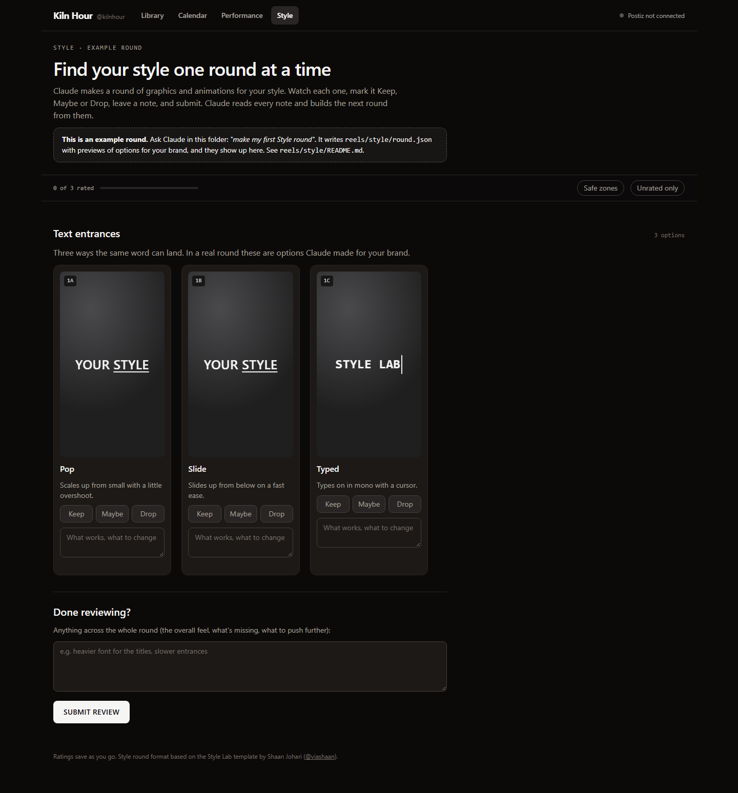

<p align="center">
  
</p>

<p align="center">
  <a href="LICENSE"></a>
  
  
  
  <!-- TIP_URL: once the Buy Me a Coffee page exists, add here:
  <a href="TIP_URL"></a>
  -->
</p>

<p align="center">
  <b>A free, open-source kit for <a href="https://claude.com/claude-code">Claude Code</a>.</b><br>
  Describe your brand once. Make motion-graphics reels and fast websites that look like you.
</p>

<p align="center">
  <a href="#quick-start">Quick start</a> ·
  <a href="#pick-your-engine">Engines</a> ·
  <a href="#the-pipeline">Pipeline</a> ·
  <a href="#dashboard">Dashboard</a> ·
  <a href="#posting">Posting</a> ·
  <a href="#sites">Sites</a> ·
  <a href="#free-vs-paid">Free vs paid</a> ·
  <a href="docs/README.md">All guides</a>
</p>

---

## What you get

<p align="center">
  
</p>

- **One brand file.** Name, voice, colours, fonts, content pillars and site details live in [`brand/brand.yaml`](brand/brand.yaml). Everything the kit makes reads it.
- **Reels.** 1080×1920 motion-graphics reels with captions, voice-over, a review sheet and a post text. Two engines, Remotion and HyperFrames; you pick one.
- **B-roll.** `/broll-scout` searches your own footage, Wikimedia Commons, Pexels and Pixabay, and logs the source and licence of every clip.
- **A local dashboard.** Review every reel from draft to live, edit captions, see your month and which hooks win.
- **A website.** React + Vite + Tailwind, SEO built in, free hosting on Cloudflare Pages.
- **Claude Code does the work** and stops at the gates that need you: the plan, the stills, and anything public. Nothing is ever posted without your yes.

**Who it's for:** creators and small businesses who post short videos and want a consistent look, without being developers. If you can download a file and paste a line into a terminal, you can use it. All the examples use an invented brand, **Kiln Hour** (hand-built pottery at home), until you make it yours.

## What the reels look like

<p align="center">
  
</p>
<p align="center"><sub>Real frames rendered by the kit from the starter reel and the example month in <code>reels/content/example/</code>, in the example brand's colours.</sub></p>

## Quick start

**Before you start** you need a [Claude Pro plan](https://claude.com/pricing) (or higher) and [Claude Code](https://claude.com/claude-code) installed. That's it: the setup installs everything else. It takes 10 to 20 minutes and about 3 GB of space.

### 1. Download the kit

On this page, click the green **Code** button → **Download ZIP**, and unzip it somewhere easy to find, like your Documents folder. (Know git? `git clone https://github.com/vgorla99/creator-kit.git` works too.)

### 2. Run the setup (one command)

Open a terminal **inside the kit's folder**:

- **Windows:** open the folder in File Explorer, click the address bar at the top, type `powershell` and press Enter.
- **Mac:** open the Terminal app, type `cd ` (with a space), drag the folder onto the Terminal window and press Enter.

Then copy this line, paste it and press Enter:

| Windows | Mac |
|---|---|
| `powershell -ExecutionPolicy Bypass -File setup\setup.ps1` | `bash setup/setup.sh` |

The setup asks what you want to make (reels, websites or both) and, for reels, which video engine. Then it lists everything it will install and **waits for your yes**. It installs only what is missing (Node.js, Python, uv, ffmpeg, Git, GitHub CLI), the kit's packages and its Claude Code skills, then checks everything and renders a test picture. Windows may ask for permission once or twice; click **Yes**.

It ends with **Done. Creator Kit is ready.** or tells you, in plain English, what to fix. You can run it again any time; it picks up where it left off. To re-check later: `npm run doctor`.

### 3. Make it yours: `/brand-intake`

Open Claude Code in the same folder (type `claude` in that terminal, or open the folder in the Claude desktop app) and type:

```
/brand-intake
```

Claude asks one question at a time (name, audience, colours, fonts, voice, posting days…) and writes your brand file. Want to prepare your answers first? Use the [brand kit template](docs/brand-kit-template.md).

### 4. Your first reel or website

- **Reel (Remotion):** `npm run starter`. Your 12-second starter reel, in your colours, lands in `reels/studio-remotion/out/Starter.mp4`.
- **Reel (HyperFrames):** `npm run hf:render` renders the 10-second starter to `reels/studio-hyperframes/out/starter.mp4`; `npm run hf:preview` opens it in your browser.
- **Or just ask Claude:** *"make a reel about …"*. It plans with you, shows you stills, and only renders when you say OK.
- **Website:** tell Claude `/site-builder`. Step by step: [Launching your website](docs/sites-launch.md).

Something not working? [Troubleshooting](docs/troubleshooting.md).

<details>
<summary><b>Useful commands</b> (all run from the kit's folder)</summary>

| Command | What it does |
|---|---|
| `npm run doctor` | checks your computer and the kit, and explains any fix |
| `npm run brand:check` | checks your brand file and tells you in plain English what to fix |
| `npm run starter` | renders the starter reel in your brand colours, plus a review sheet |
| `npm run produce -- example --only V01` | renders the example month's video: video, cover, review sheet, voice-over script, post text |
| `npm start` | opens Remotion Studio in your browser, where you can scrub every reel |
| `npm run hf:preview` · `hf:check` · `hf:snapshot` · `hf:render` | the HyperFrames studio: preview in the browser, check, key frames, render |
| `npm run dashboard` | the local dashboard on http://localhost:5180 (Ctrl+C stops it) |
| `npm run broll -- search "<words>"` | searches stock B-roll (Claude's `/broll-scout` does this for you) |
| `npm run library -- credits` | prints the credit lines your post needs for the clips you used |

Keys for optional services go in `.env` (the setup creates it; every key is optional and stays on your computer). `npm run doctor` tells you which stock keys are set without showing them; Wikimedia Commons needs no key. More: [Privacy and keys](docs/privacy.md).

| Key | Used for |
|---|---|
| `PEXELS_API_KEY` | stock clips from Pexels (free key: [pexels.com/api](https://www.pexels.com/api/)) |
| `PIXABAY_API_KEY` | stock clips from Pixabay (free key: [pixabay.com/api/docs](https://pixabay.com/api/docs/)) |
| `ELEVENLABS_API_KEY` | voice-over |
| `POSTIZ_API_KEY`, `POSTIZ_API_URL` | scheduling with Postiz (see [Posting](#posting)), and the dashboard's queue and numbers |
| `PUBLORA_API_KEY` | scheduling with Publora |

</details>

## Pick your engine

Both engines read the same brand file, use the same content folders and the same sound library. Neither is the default.

<p align="center">
  
</p>

<p align="center">
  
  &nbsp;&nbsp;&nbsp;
  
</p>
<p align="center"><sub>The two starter reels, as rendered on a fresh copy: Remotion (left, 12 s) and HyperFrames (right, 10 s).</sub></p>

| | **Remotion** | **HyperFrames** |
|---|---|---|
| A reel is | a React component | a web page (HTML + CSS + GSAP) |
| Best for | a month of reels from one plan, real footage, consistent series | one-off motion pieces, kinetic type, promos |
| Starter | `npm run starter` | `npm run hf:render` |
| Licence | free for individuals and companies up to 3 people | Apache-2.0, free for everyone |

Full comparison and how Claude routes a reel: **[Pick your engine](docs/engines.md)**.

## The pipeline



Claude runs every step and stops at the three gates. Every motion reel is checked against [12 rules](docs/the-standard.md). Step by step: **[The reel pipeline](docs/pipeline.md)**. How to write hooks and test two of them with trial reels: **[Playbook](docs/playbook.md)**.

## Dashboard

`npm run dashboard`, then open http://localhost:5180. It runs on your computer only and never posts anything.

| | |
|---|---|
|  |  |
| **Library:** every reel and carousel, draft → ready → live | **Detail:** watch, edit the caption, write notes, approve |
|  |  |
| **Calendar:** your plan and the Postiz queue | **Style:** rate options Keep / Maybe / Drop ([Style Lab](docs/style-lab.md)) |

The **Performance** tab shows which hook types win: [Analytics](docs/analytics.md). Details: [dashboard README](reels/dashboard/README.md).

## Posting

Rendering never posts anything. When a reel is approved, schedule it one of three ways:

| Route | Cost | Effort | Guide |
|---|---|---|---|
| Each platform's own scheduler | free | a few minutes per reel, per platform | [Native schedulers](docs/posting-native.md) |
| Postiz on your own small server | about €7–8/month, or €0 on a free-tier server | about 2 hours to set up, then one calendar | [Postiz self-hosted](docs/postiz-self-host.md) |
| Postiz Cloud | from $29/month | 20 minutes, nothing to maintain | [Postiz Cloud](docs/postiz-cloud.md) |

Sizes, limits and safe zones per app: [Platforms](docs/platforms.md). Sound effects, music and loudness: [Sounds](docs/sounds.md).

## Sites

The same brand file builds a website: React + Vite + Tailwind, one real HTML page per URL, SEO built in, free hosting on Cloudflare Pages.

<p align="center">
  
  
</p>

- **Pages:** home (hero, offer, proof, lead form and pop-up), about, contact, and a long-answer article that answers one real question in full.
- **SEO pack:** sitemap, `robots.txt` that welcomes AI crawlers, `llms.txt`, JSON-LD structured data, titles, descriptions and share images. `npm run check-seo` checks all of it.
- **Fast and accessible:** the example scores 100 on all four Lighthouse scores on mobile. Fonts are self-hosted, and motion switches off for visitors who ask for reduced motion.
- **Two Claude Code skills:** `/niche-research` (competitors, long questions, answer gaps) and `/site-builder` (plan → your OK → build → SEO pack → launch).

Step by step, for non-developers: **[Launching your website](docs/sites-launch.md)**, then the monthly **[Search Console check](docs/search-console.md)**.

## Free vs paid

Everything in the kit is free. Some services are optional and paid; the free path always works.

| Need | Free path | Paid option |
|---|---|---|
| Claude | Claude Pro (the minimum) | Max |
| Video engine | Remotion (individuals, companies up to 3 people) or HyperFrames | [Remotion company license](https://www.remotion.dev/license) for bigger teams |
| Voice | your own voice | ElevenLabs |
| B-roll | your own footage, Wikimedia Commons, Pexels, Pixabay (free keys) | stock or AI video services |
| Sound effects | the recommended free pack ([Sounds](docs/sounds.md)) | paid libraries |
| Posting | each app's own scheduler | Postiz on a small server (about €7–8/month) or Postiz Cloud |
| Website hosting | Cloudflare Pages free tier | a domain (about €10/year) |

## Guides

| Start | Reels | Posting and numbers | Sites | More |
|---|---|---|---|---|
| [Brand kit template](docs/brand-kit-template.md) | [Playbook](docs/playbook.md) | [Native schedulers](docs/posting-native.md) | [Launching your website](docs/sites-launch.md) | [Privacy and keys](docs/privacy.md) |
| [Pick your engine](docs/engines.md) | [The standard](docs/the-standard.md) | [Postiz self-hosted](docs/postiz-self-host.md) | [Search Console](docs/search-console.md) | [Contributing](docs/CONTRIBUTING.md) |
| [The reel pipeline](docs/pipeline.md) | [Reels with Remotion](docs/reels-remotion.md) | [Postiz Cloud](docs/postiz-cloud.md) | | [Credits](CREDITS.md) |
| [Troubleshooting](docs/troubleshooting.md) | [Platforms](docs/platforms.md) · [Sounds](docs/sounds.md) | [Analytics](docs/analytics.md) | | |
| | [Style Lab](docs/style-lab.md) | | | |

All guides in one list: [docs/README.md](docs/README.md).

## What's inside

| Path | What it is |
|---|---|
| `brand/` | your brand: `brand.yaml` (the facts) and `STYLE.md` (the feel) |
| `schema/` | the rules for `brand.yaml` and the checker behind `npm run brand:check` |
| `reels/studio-remotion/` | the Remotion reel studio: starter reel, footage engine, 10 animated blocks, captions, carousels, scripts |
| `reels/studio-hyperframes/` | the HyperFrames reel studio: a starter reel built as an HTML page |
| `reels/dashboard/` | the local dashboard: review, captions, calendar, numbers, Style rounds |
| `reels/content/` | what you post: ideas, ready, live, metrics, and month plans (`example/` renders on a fresh copy) |
| `reels/sounds/` | how to get and index sound effects (the packs stay on your computer) |
| `reels/style/` | your Style Lab rounds (stay on your computer) |
| `sites/template/` | the website template: React + Vite + Tailwind, SEO scripts |
| `setup/` | the one-command setup, `doctor`, and the list of skills it installs (`skills.lock.yaml`) |
| `.claude/` | how Claude works here (`CLAUDE.md`), safe permissions, and the kit's own skills |
| `docs/` | the guides |
| `assets/` | Creator Kit logo files and README images (sources in `assets/readme/src/`) |

## Roadmap

- [x] Remotion reel engine, footage engine, monthly plans, carousels
- [x] One `brand.yaml` with a schema, a guided brand intake and an invented example brand
- [x] HyperFrames studio as a second reel engine, side by side with Remotion
- [x] One-command setup for Windows and macOS, with a `doctor` check (tested on Windows; the macOS script is syntax-checked, not yet run on a Mac)
- [x] `broll-scout`: licence-logged B-roll from your footage, Wikimedia, Pexels and Pixabay
- [x] Local dashboard: library, review, calendar, performance, Style Lab
- [x] `sites/`: React + Vite + Tailwind template, niche research, Cloudflare Pages deploy
- [x] Guides for every part
- [ ] Postiz self-host guide tested end to end on a fresh server
- [ ] v2.0.0 release

## Principles

- **Your brand, not ours.** Examples use an invented brand. Nothing in the repo belongs to a real business.
- **Secrets stay local.** Keys live in `.env`, which is git-ignored. Nothing is uploaded unless you run a command for it.
- **A human approves anything public.** Nothing is posted by a render; posting always asks for your yes first.
- **Installed, not copied.** Third-party skills and tools are installed from their own repositories, with their own licences.

## Earlier versions

| Tag | What it is |
|---|---|
| [`v1.1.0`](https://github.com/vgorla99/creator-kit/tree/v1.1.0) | ReelsMaker: morphing single-protagonist motion kit |
| [`v1.0.0`](https://github.com/vgorla99/creator-kit/tree/v1.0.0) | ReelsMaker: JSON-script text-card reels |

This repository was called `reelsmaker`; old links redirect here.

## Credits and licence

Code: [MIT](LICENSE). Fonts: SIL Open Font License. Third-party skills, tools and the Style Lab idea: see [CREDITS.md](CREDITS.md).

[Remotion](https://www.remotion.dev) has its own licence. It is free for individuals and companies of up to 3 people; larger companies need a [Remotion company license](https://www.remotion.dev/license).

<!-- TIP_URL: add the Buy Me a Coffee link here once the page exists, e.g. "**Like the kit?** [Buy me a coffee](TIP_URL) to help keep it free." -->

