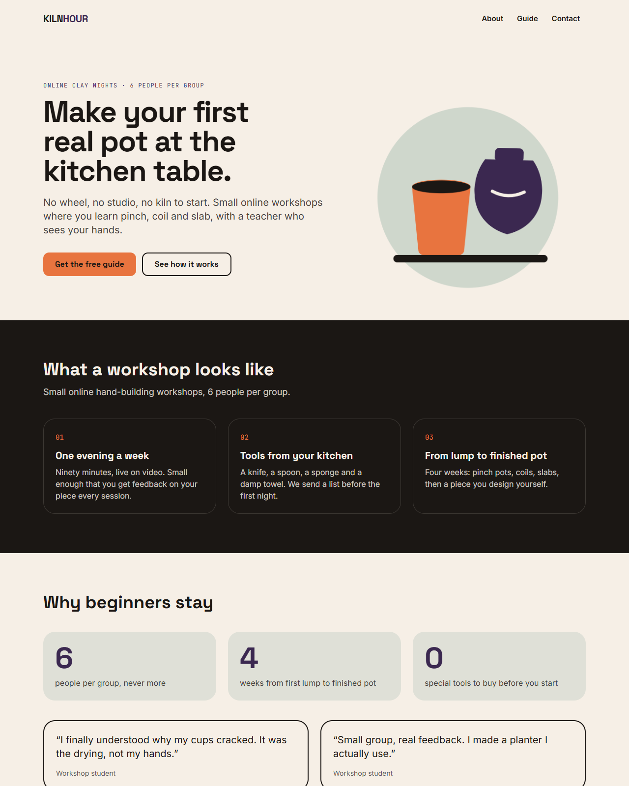

<p align="center">
  
</p>

<p align="center">
  <a href="LICENSE"></a>
  
  
  
</p>

<p align="center">
  <b>A free, open-source kit for <a href="https://claude.com/claude-code">Claude Code</a>.</b><br>
  Describe your brand once. Make motion-graphics reels and fast websites that look like you.
</p>

<p align="center">
  <a href="#quick-start">Quick start</a> ·
  <a href="#how-it-works">How it works</a> ·
  <a href="#posting">Posting</a> ·
  <a href="#sites">Sites</a> ·
  <a href="#whats-inside">What's inside</a> ·
  <a href="#roadmap">Roadmap</a> ·
  <a href="docs/reels-remotion.md">Reels guide</a>
</p>

---

> [!NOTE]
> **Creator Kit v2 is being built in the open.** The Remotion reel engine works today and is documented below. Your brand lives in one file, [`brand/brand.yaml`](brand/brand.yaml). The site builder lives in [`sites/`](#sites). The HyperFrames studio and the one-command setup are on the [roadmap](#roadmap).

## How it works

<p align="center">
  
</p>

1. **Describe once.** Name, voice, colours, fonts, content pillars and site details go in one brand file. Keys and tokens stay in `.env` and never in the brand file.
2. **Make reels.** Write a script or a monthly plan. The kit renders 1080×1920 reels with captions, voice-over, music and a review sheet.
3. **Make sites**. The same brand file drives a React + Vite + Tailwind site with SEO built in, ready for Cloudflare Pages.

Claude Code runs the steps for you and stops at the gates that need a human: approving a script, recording a voice, publishing a post.

## What the reels look like

<p align="center">
  
</p>
<p align="center"><sub>Real frames rendered by the kit from the example month in <code>reels/content/example/</code>, using the demo brand.</sub></p>

## Quick start

You need **Node 20 or newer** ([nodejs.org](https://nodejs.org), pick "LTS") and **Git**. Remotion downloads its own headless browser and ships ffmpeg, so there is nothing else to install.

Open a terminal (Windows: PowerShell, Mac: Terminal) and paste these lines one at a time:

```bash
git clone https://github.com/vgorla99/creator-kit.git
cd creator-kit
npm install
```

Then try it. Every command below runs from the `creator-kit` folder:

| Command | What it does |
|---|---|
| `npm run starter` | renders the 12-second starter reel in your brand colours, plus a review sheet |
| `npm run produce -- example --only V01` | renders the example month's video: video, cover, review sheet, voice-over script, post text |
| `npm start` | opens Remotion Studio in your browser, where you can scrub every reel |
| `npm run brand:check` | checks your brand file and tells you in plain English what to fix |

Your videos land in `reels/studio-remotion/out/`. The first render takes a minute longer while Remotion downloads its browser.

Then make it yours:

1. Open Claude Code in this folder and type `/brand-intake`: it asks you one question at a time, writes your [`brand/brand.yaml`](brand/brand.yaml) and [`brand/STYLE.md`](brand/STYLE.md), and checks them. Prefer editing by hand? Change `brand/brand.yaml` (it ships with an invented example brand, Kiln Hour) and run `npm run brand:check`.
2. Copy `.env.example` to `.env` and add the keys you need. Each one is optional:

   | Key | Used for |
   |---|---|
   | `PEXELS_API_KEY` | searching and downloading stock clips |
   | `ELEVENLABS_API_KEY` | voice-over |
   | `PUBLORA_API_KEY` | scheduling finished videos |

3. Plan a month: copy the folder [`reels/content/example/`](reels/content/example/) to `reels/content/<yyyy-mm>/` (for example `reels/content/2026-03/`), edit its `plan.json`, register it in [`reels/studio-remotion/src/plan/index.ts`](reels/studio-remotion/src/plan/index.ts) (Claude Code can do this for you), then run `npm run produce -- 2026-03 --week 1`.
4. Optional: download the free sound-effects pack described in [`reels/sounds/SOUND-LIBRARY.md`](reels/sounds/SOUND-LIBRARY.md).

The full reference (plan format, blocks, captions, audio, the motion kit) is in the **[reels guide](docs/reels-remotion.md)**.

## Posting

Rendering never posts anything. When a reel is approved, schedule it one of three ways:

| Route | Cost | Effort | Guide |
|---|---|---|---|
| Each platform's own scheduler | free | a few minutes per reel, per platform | [Native schedulers](docs/posting-native.md) |
| Postiz on your own small server | about €7–8/month, or €0 on a free-tier server | about 2 hours to set up, then one calendar | [Postiz self-hosted](docs/postiz-self-host.md) |
| Postiz Cloud | from $29/month | 20 minutes, nothing to maintain | [Postiz Cloud](docs/postiz-cloud.md) |

## Sites

The same brand file builds a website: React + Vite + Tailwind, one real HTML page per URL, SEO built in, free hosting on Cloudflare Pages.

<p align="center">
  
  
</p>

- **Pages:** home (hero, offer, proof, lead form and pop-up), about, contact, and a long-answer article that answers one real question in full.
- **SEO pack:** sitemap, `robots.txt` that welcomes AI crawlers, `llms.txt`, JSON-LD structured data, titles, descriptions and share images. `npm run check-seo` checks all of it.
- **Fast and accessible:** the example scores 100 on all four Lighthouse scores on mobile. Fonts are self-hosted, and motion switches off for visitors who ask for reduced motion.
- **Two Claude Code skills:** `/niche-research` (competitors, long questions, answer gaps) and `/site-builder` (plan → your OK → build → SEO pack → launch, then a monthly Search Console check).

```bash
cd sites/template
npm install
npm run build && npm run check-seo
```

Step by step, for non-developers: **[Launching your website](docs/sites-launch.md)** (build, Cloudflare Pages, your domain, Search Console).

## What's inside

| Path | What it is |
|---|---|
| `brand/` | your brand: `brand.yaml` (the facts) and `STYLE.md` (the feel) |
| `schema/` | the rules for `brand.yaml` and the checker behind `npm run brand:check` |
| `reels/studio-remotion/` | the Remotion reel studio: starter reel, footage engine, 10 animated blocks, captions, carousels, scripts |
| `reels/content/` | what you post: ideas, ready, live, metrics, and month plans (`example/` renders on a fresh copy) |
| `reels/sounds/` | how to get and index sound effects (the packs themselves stay on your computer) |
| `sites/template/` | the website template: React + Vite + Tailwind, SEO scripts |
| `sites/research/` | your niche research and monthly notes (stays on your computer) |
| `docs/` | guides: reels, posting, site launch |
| `assets/` | Creator Kit logo files and README images |

## Roadmap

- [x] Remotion reel engine, footage engine, monthly plans, carousels
- [x] Production scripts: stock clips, voice-over, review documents, scheduling
- [x] One `brand.yaml` with a schema, plus a guided brand intake and an invented example brand
- [x] `reels/` restructure: Remotion studio, content folders, sound library guide
- [ ] HyperFrames studio as a second reel builder, side by side with Remotion
- [ ] One-command setup for Windows and macOS, with a `doctor` check
- [ ] `broll-scout`: licence-logged B-roll from Pexels, Pixabay and Wikimedia
- [ ] Local dashboard: plans, review, style, analytics
- [ ] Posting guides: Postiz self-hosted, Postiz Cloud, native schedulers (written; self-host guide being tested on a fresh server)
- [x] `sites/`: React + Vite + Tailwind template, niche research, Cloudflare Pages deploy

## Principles

- **Your brand, not ours.** Examples use a neutral demo brand. Nothing in the repo belongs to a real business.
- **Secrets stay local.** Keys live in `.env`, which is git-ignored. Nothing is uploaded unless you run a publishing command.
- **A human approves anything public.** Nothing is posted by a render; scheduling is a separate command you run after reviewing the post.
- **Installed, not copied.** Third-party skills and tools are installed from their own repositories, with their own licences.

## Earlier versions

| Tag | What it is |
|---|---|
| [`v1.1.0`](https://github.com/vgorla99/creator-kit/tree/v1.1.0) | ReelsMaker: morphing single-protagonist motion kit |
| [`v1.0.0`](https://github.com/vgorla99/creator-kit/tree/v1.0.0) | ReelsMaker: JSON-script text-card reels |

This repository was called `reelsmaker`; old links redirect here.

## License

Code: [MIT](LICENSE). Fonts: SIL Open Font License.

[Remotion](https://www.remotion.dev) has its own licence. It is free for individuals and companies of up to 3 people; larger companies need a [Remotion company license](https://www.remotion.dev/license).

<!-- TIP_URL: add the Buy Me a Coffee link here once the page exists. -->
