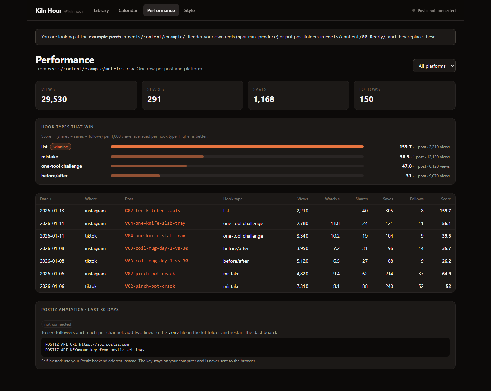

# Analytics: learn from your numbers

> Part of [Creator Kit](../README.md). Keep one row per post, see which hooks win in the dashboard, and let Claude plan next month from what actually worked.

## 1. One file for all your numbers

Your numbers live in **`reels/content/_metrics/metrics.csv`**, a simple table you can open in Excel, Numbers or Google Sheets. The first line is the header; keep it exactly as it is:

```
date,platform,post_id,reel_id,title,url,views,reach,likes,comments,shares,saves,follows,avg_watch_s,completion_pct,hook_type
```

| Column | What to put |
|---|---|
| `date` | the day it went live, `2026-03-04` |
| `platform` | `instagram`, `tiktok` or `youtube` |
| `post_id`, `url` | the platform's id and link (optional) |
| `reel_id` | the post's folder name, e.g. `V03-coil-mug-day-1-vs-30`, or its ID |
| `views` … `follows` | from the app's insights; leave a cell empty if you don't know it |
| `avg_watch_s`, `completion_pct` | average watch time in seconds, and % who watched to the end, if the app shows it |
| `hook_type` | the hook type you used (see [playbook.md](playbook.md)); this is what makes the hook table work |

**Never guess a number.** An empty cell is better than a made-up one.

You don't have to type it yourself:

- **With Postiz:** ask Claude *"pull the numbers for last week's posts"*. The `post-video` skill reads them from Postiz and adds the rows.
- **Without Postiz:** take a screenshot of each post's insights and give it to Claude. It fills the rows.

When to fill: about 7 days after posting, when most views have come in. Numbers only grow, so refresh older rows now and then.

An example with made-up numbers for the invented brand is in [`reels/content/example/metrics.csv`](../reels/content/example/metrics.csv).

## 2. See it in the dashboard

`npm run dashboard`, then open http://localhost:5180 → **Performance**.

<p align="center"></p>

- Views and engagement per post, from `metrics.csv`.
- **Which hook types win**, by a score: shares + saves + follows per 1,000 views. Views tell you how far the hook carried the reel; this score tells you whether people valued it.
- If Postiz is connected (key in `.env`), analytics per channel, read-only.

## 3. Plan next month from it

Once a month, ask Claude: *"plan next month from my numbers"*. The `content-calendar-from-analytics` skill:

1. reads `metrics.csv` (and Postiz, if you use it)
2. groups posts by hook type, topic (pillar), day and hour, and compares **medians**, so one viral post doesn't fool it
3. tells you honestly how sure it is: fewer than 5 posts in a group is a hint, not a finding
4. drafts a calendar: about 60 % of posts on the hook types that win, about 20 % testing something new, the rest on your best topic
5. **waits for your OK**, then writes `reels/content/<yyyy-mm>/CALENDAR.md` and can turn it into that month's `plan.json`

With fewer than 6 posts that have numbers, it says the sample is too small and plans from your brand file instead, with a test of two hook types.
