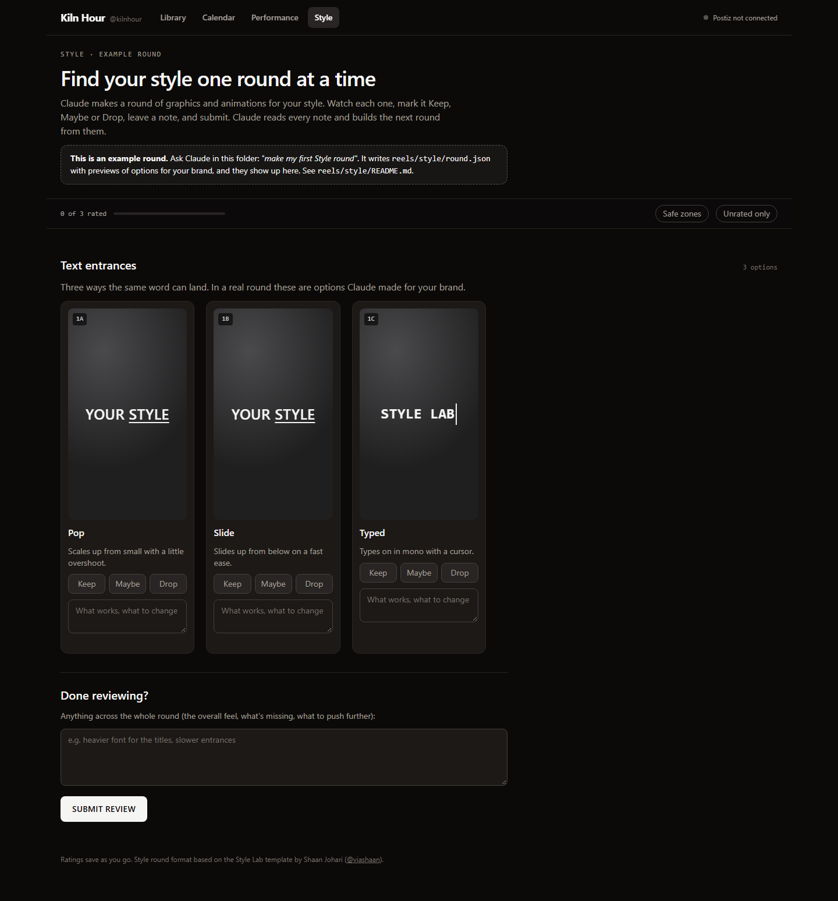

# Style Lab: find your look in rounds

> Part of [Creator Kit](../README.md). Instead of describing a style in words, you rate real options. Claude makes a round, you mark each option Keep, Maybe or Drop, and the next round builds on your notes until your look is locked in `brand/STYLE.md`.

The idea and round format come from the Style Lab template by Shaan Johari ([@viashaan](https://instagram.com/viashaan)), reused with permission ([CREDITS.md](../CREDITS.md)).

## How a round works

1. **Ask Claude for a round.** For example: *"start a style round: titles and entrances"*. Claude makes 3 to 6 short options per section (title styles, entrances, transitions, sounds…). Each option changes **one** thing, with the same words and footage, so you compare like with like.
2. **Open the dashboard.** `npm run dashboard`, then http://localhost:5180 → **Style**. Each option plays as a short muted loop; click it to see it large, with sound if it has any.
3. **Rate every card.** **Keep**, **Maybe** or **Drop**, plus a short note: *"keep, but slower"*, *"drop: too busy"*. Ratings save as you click. The **Unrated** filter shows what's left; **Safe zones** shows where Instagram's buttons would sit.
4. **Submit.** Write one overall note and press **Submit review**.
5. **Tell Claude "done".** It reads your ratings, sums up what you kept, dropped and why, updates `brand/STYLE.md` (Locked, Rejected, open questions) and builds the next round: every Maybe fixed as your note says, the Keeps pushed further, the Drops left out.

Two or three rounds are usually enough to lock titles, motion and sound.

## Where the files are

Everything is in `reels/style/` and stays on your computer (git-ignored), except its README:

| File | What |
|---|---|
| `round.json` | the current round, written by Claude |
| `media/` | one preview per option |
| `ratings.json` | your ratings, saved by the dashboard |
| `submissions/` | one file per **Submit review** |

The full format, for Claude and for the curious: [`reels/style/README.md`](../reels/style/README.md). Until you have a round of your own, the Style tab shows an example round.

## After the lab

What you locked becomes rules: `brand/STYLE.md` describes the feel in words, and `motion.locked_terms` / `motion.rejected_terms` in `brand/brand.yaml` list the moves to always use and never use. Every reel Claude plans after that follows them.
